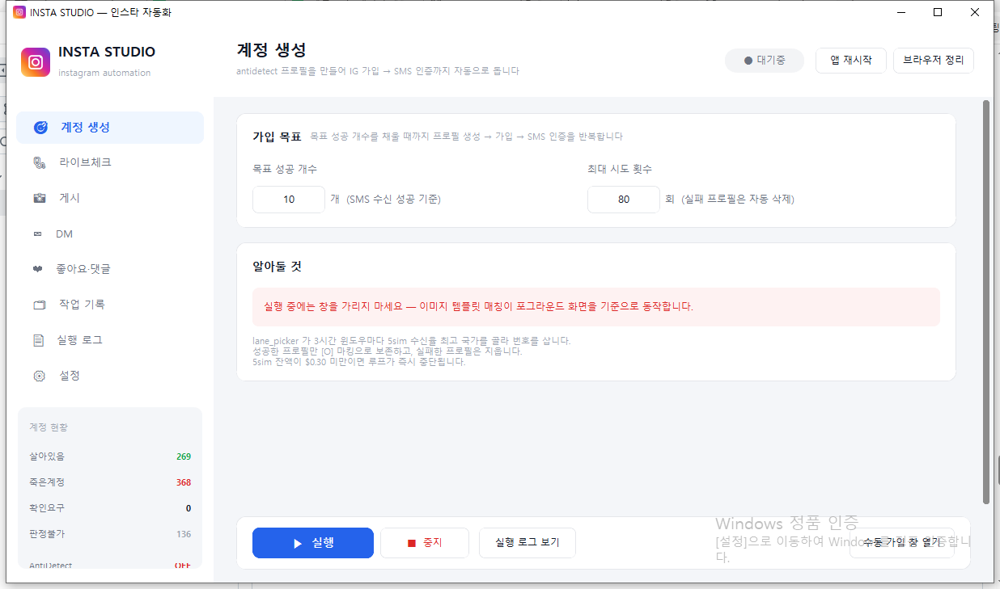
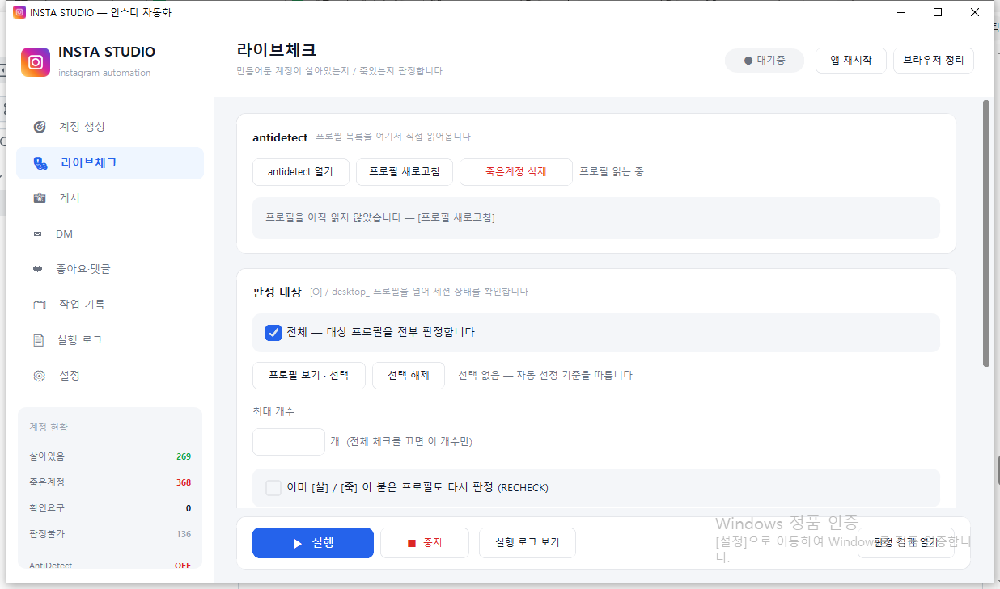
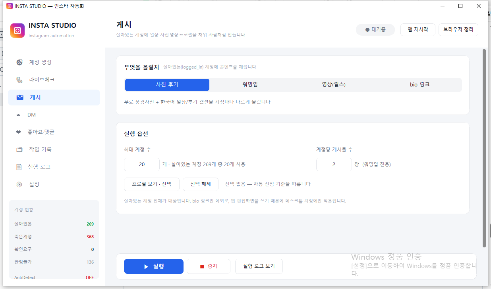
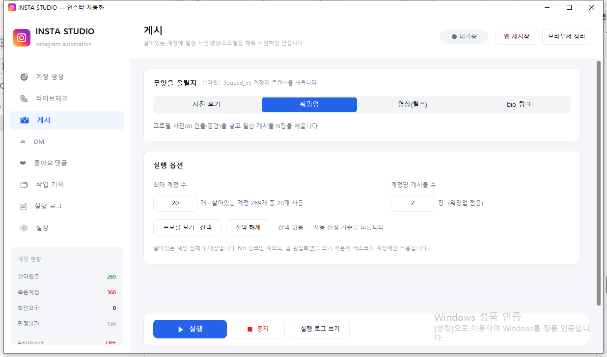
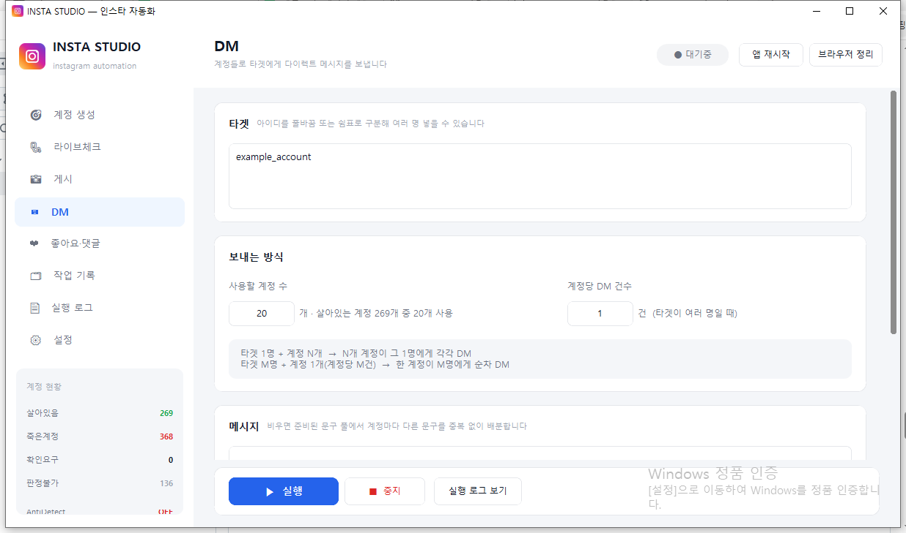
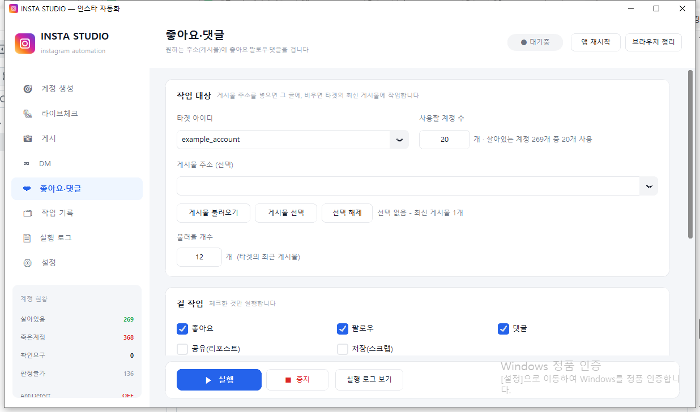
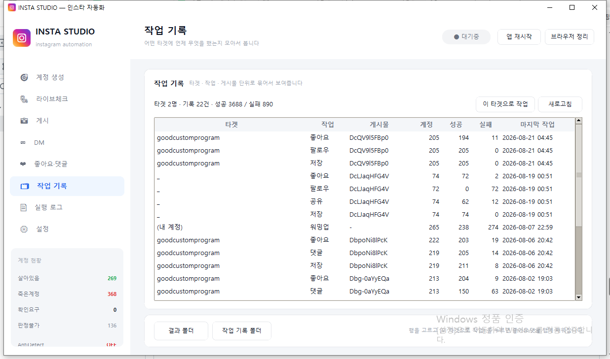
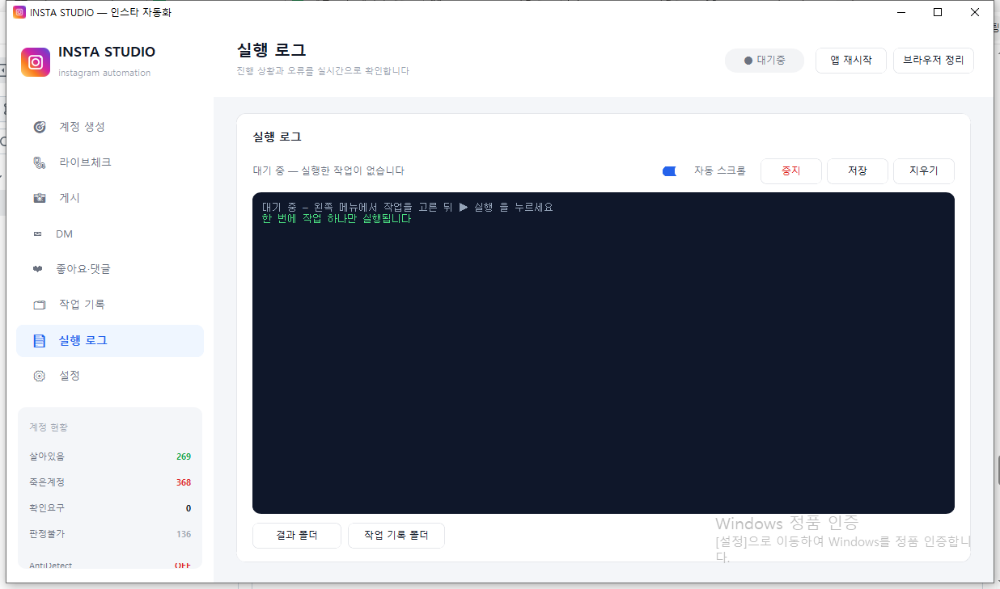

# INSTA STUDIO 사용설명서

프로그램 화면을 하나씩 짚어가며 설명합니다. 처음 쓰시는 분은 위에서부터 순서대로 따라 하시면 됩니다.

아이디 생성부터 게시 · 소통 · 운영까지 한 화면에서 진행합니다. 이 문서는 화면 사용법만 다룹니다.

- [1. 이 프로그램으로 할 수 있는 일](#1-이-프로그램으로-할-수-있는-일)
- [2. 시작하기](#2-시작하기)
- [3. 화면 구성](#3-화면-구성)
- [4. 권장 작업 순서](#4-권장-작업-순서)
- [5. 계정 생성 — 아이디 만들기](#5-계정-생성--아이디-만들기)
- [6. 라이브체크 — 아이디 상태 확인](#6-라이브체크--아이디-상태-확인)
- [7. 게시 — 생성된 아이디로 콘텐츠 채우기](#7-게시--생성된-아이디로-콘텐츠-채우기)
- [8. DM — 다이렉트 메시지](#8-dm--다이렉트-메시지)
- [9. 좋아요 · 댓글 — 타겟 작업](#9-좋아요--댓글--타겟-작업)
- [10. 프로필 보기 · 선택](#10-프로필-보기--선택)
- [11. 작업 기록](#11-작업-기록)
- [12. 실행 로그](#12-실행-로그)
- [13. 설정](#13-설정)
- [14. 작업 중단과 이어서 하기](#14-작업-중단과-이어서-하기)
- [15. 꼭 지켜 주세요](#15-꼭-지켜-주세요)
- [16. 자주 묻는 질문](#16-자주-묻는-질문)
- [한 장 요약](#한-장-요약)

---

## 1. 이 프로그램으로 할 수 있는 일

INSTA STUDIO 는 인스타그램 아이디를 만들고, 그 아이디로 운영 작업을 한 화면에서 돌리는 프로그램입니다. 왼쪽 메뉴가 곧 기능 목록입니다.

| 메뉴 | 하는 일 | 언제 쓰나 |
|---|---|---|
| 계정 생성 | 인스타그램 아이디를 목표 개수만큼 만듭니다. | 아이디가 필요할 때 |
| 라이브체크 | 이미 만든 아이디가 정상인지, 정지됐는지 가립니다. | 작업 전에 반드시 |
| 게시 | 사진 · 영상 · 프로필 사진 · 소개글을 올려 사람처럼 보이게 합니다. | 새 아이디를 만든 직후 |
| DM | 만든 아이디들로 상대에게 메시지를 보냅니다. | 홍보 · 안내 · 협업 연락 |
| 좋아요 · 댓글 | 상대 아이디 또는 특정 게시물에 좋아요 · 팔로우 · 댓글 · 공유 · 저장을 합니다. | 관심 유도 · 소통 |
| 작업 기록 | 어느 타겟에 무엇을 했는지 모아 봅니다. | 중복 작업 확인 |
| 실행 로그 | 지금 돌아가는 작업의 진행 상황을 실시간으로 봅니다. | 실행 중 항상 |
| 설정 | 소개 링크, 영상 폴더, 계정 사이 대기 시간 등 운영 값을 바꿉니다. | 처음 한 번, 이후 필요할 때 |

### 생성된 아이디로 바로 할 수 있는 일

아이디가 만들어지고 라이브체크에서 **살아있음**으로 나오면, 그 아이디로 아래를 실행할 수 있습니다.

| 기능 | 결과 |
|---|---|
| 워밍업 | 프로필 사진 1장 + 일상 게시물 여러 장을 채웁니다. 빈 계정처럼 보이지 않게 합니다. |
| 사진 후기 | 계정마다 다른 풍경 사진과 한국어 캡션을 올립니다. |
| 영상(릴스) | 지정한 폴더의 영상을 릴스로 올립니다. |
| 소개(bio) 링크 | 프로필 소개문과 클릭 가능한 링크를 넣습니다. |
| 좋아요 | 지정한 게시물(또는 타겟의 최신 글)에 좋아요를 누릅니다. |
| 팔로우 | 타겟 아이디를 팔로우합니다. |
| 댓글 | 게시물에 계정마다 다른 문구로 댓글을 답니다. |
| 공유(리포스트) | 게시물을 스토리/공유로 다시 올립니다. |
| 저장(스크랩) | 게시물을 저장합니다. |
| DM | 타겟에게 다이렉트 메시지를 보냅니다. |

작업은 동시에 두 개를 돌리지 않습니다. 계정 생성 중에 게시를 누르면 서로 방해합니다. 하나를 끝낸 뒤 다음을 실행하세요.

---

## 2. 시작하기

프로그램을 켜면 이런 화면입니다. 왼쪽에서 메뉴를 고르고, 가운데를 채운 뒤 아래 **▶ 실행**을 누릅니다.

1. INSTA STUDIO 를 실행합니다. 창 제목은 **INSTA STUDIO — 인스타 자동화**입니다.
2. 왼쪽 사이드바에서 할 일을 고릅니다.
3. 가운데 화면에서 숫자·타겟·옵션을 채웁니다.
4. 아래쪽 **▶ 실행**을 누릅니다. 진행 내용은 **실행 로그** 탭에 실시간으로 나옵니다.
5. 멈추려면 로그 화면 또는 아래 막대의 **■ 중지**를 누릅니다.

처음 켰을 때 설정이 비어 있으면 설정 화면으로 안내됩니다. 연결 정보는 설치 담당자가 넣어 둔 값입니다. 일반 사용자는 콘텐츠(소개 링크, 영상 폴더)와 대기 시간만 확인하면 됩니다.

---

## 3. 화면 구성

| 위치 | 이름 | 역할 |
|---|---|---|
| 왼쪽 | 사이드바 | 메뉴 이동. 아래쪽에 현재 상태(대기중 / 실행중 / 완료 / 중지됨)가 보입니다. |
| 위 | 헤더 | 지금 메뉴의 제목과 짧은 설명. 오른쪽 상태 표시. |
| 가운데 | 작업 카드 | 숫자 입력, 체크, 타겟, 문구 등 그 메뉴의 설정. |
| 아래 | 실행 막대 | ▶ 실행, ■ 중지. 스크롤과 관계없이 항상 보입니다. |

헤더 오른쪽의 상태 표시는 대략 이렇게 바뀝니다.

| 표시 | 뜻 |
|---|---|
| 대기중 | 지금 돌아가는 작업이 없습니다. |
| 실행중 | 선택한 작업이 진행 중입니다. |
| 완료 | 목표까지 끝났습니다. |
| 중지됨 | 사용자가 멈췄거나, 더 진행할 수 없어 멈춘 상태입니다. |

---

## 4. 권장 작업 순서

아이디를 만든 직후 바로 좋아요·DM 을 걸면 빈 계정으로 보이기 쉽습니다. 아래 순서를 권장합니다.

1. **계정 생성** — 필요한 개수만큼 아이디를 만듭니다.
2. **라이브체크** — 만들어진 아이디가 정상인지 가립니다. 정지된 것은 삭제합니다.
3. **게시 → 워밍업** — 프로필 사진과 일상 글을 채웁니다.
4. (선택) **사진 후기** 또는 **영상** — 콘텐츠를 더 올립니다.
5. (선택) **소개 링크** — 프로필에 안내 문구와 링크를 넣습니다.
6. **좋아요 · 댓글** 또는 **DM** — 타겟 작업을 합니다.
7. **작업 기록**에서 중복 여부를 확인합니다.

게시 · DM · 좋아요는 **살아있음**으로 판정된 아이디만 대상으로 합니다. 라이브체크를 건너뛰면 작업할 계정이 없거나, 이미 정지된 아이디를 계속 열게 됩니다.

---

## 5. 계정 생성 — 아이디 만들기

왼쪽 **계정 생성**을 엽니다. 목표 개수를 채울 때까지 아이디를 반복해서 만듭니다. 성공한 아이디만 남고, 만들지 못한 시도는 자동으로 정리됩니다.

### 입력 항목

| 항목 | 뜻 | 예시 |
|---|---|---|
| 목표 성공 개수 | 이번에 만들고 싶은 아이디 수입니다. 성공할 때까지 반복합니다. | 10 |
| 최대 시도 횟수 | 목표를 못 채워도 이 횟수에서 멈춥니다. 실패를 감안한 한도입니다. | 80 |

### 실행 방법

1. 목표 성공 개수와 최대 시도 횟수를 넣습니다.
2. **▶ 실행**을 누릅니다.
3. 실행 로그로 넘어가 진행을 봅니다. 아이디가 하나 만들어질 때마다 기록됩니다.
4. 목표를 채우면 자동으로 끝납니다. 중간에 멈추려면 **■ 중지**입니다.

**실행 중 화면을 가리지 마세요.** 계정 생성은 화면에 보이는 버튼을 기준으로 진행됩니다. 다른 창을 위에 올리거나, 자리를 비운 사이 화면 보호기가 켜지면 단계가 어긋날 수 있습니다. 끝날 때까지 이 컴퓨터 화면을 그대로 두세요.

### 끝나면

- 성공한 아이디는 목록에 남습니다. 이후 라이브체크 · 게시 · DM · 좋아요의 재료가 됩니다.
- 만들지 못한 시도는 남지 않습니다. 목표만 모입니다.
- 더 만들 수 없는 상태가 되면 프로그램이 멈추고 이어서 할지 물어봅니다. 14장을 보세요.

---

## 6. 라이브체크 — 아이디 상태 확인

만들어 둔 아이디를 하나씩 열어, 지금 쓸 수 있는지 가립니다. 게시 · DM · 좋아요는 이 결과를 보고 **살아있음**만 고릅니다.

### 판정 결과

| 화면에 보이는 말 | 뜻 | 다음에 할 일 |
|---|---|---|
| 살아있음 | 로그인이 유지된 정상 계정입니다. | 게시 · 워밍업 · DM · 좋아요 대상 |
| 죽은계정 | 정지가 확인된 계정입니다. | **죽은계정 삭제**로 정리 |
| 확인요구 | 본인 확인 화면이 뜬 상태입니다. 계정 자체는 살아 있습니다. | 필요하면 직접 확인 후 재사용 |
| 판정불가 | 로그인 정보가 없어 생사를 알 수 없습니다. | 다시 로그인하거나 재판정 |

### 화면 버튼

| 버튼 · 옵션 | 하는 일 |
|---|---|
| 프로필 새로고침 | 지금 가지고 있는 아이디 목록과 개수를 다시 읽습니다. |
| 죽은계정 삭제 | **죽은계정**으로 판정된 것만 영구 삭제합니다. 되돌릴 수 없습니다. |
| 전체 | 대상 아이디를 모두 판정합니다. |
| 최대 개수 | 전체를 끄면 이 숫자만큼만 판정합니다. |
| 이미 붙은 것도 다시 판정 | 예전에 살아있음/죽은계정으로 찍힌 것도 오늘 다시 봅니다. |
| 프로필 보기 · 선택 | 목록에서 원하는 아이디만 골라 그것만 판정합니다. |

### 실행 방법

1. **프로필 새로고침**으로 목록이 읽히는지 확인합니다.
2. 전체를 검사할지, 개수를 제한할지, 특정 아이디만 고를지 정합니다.
3. **▶ 실행**을 누릅니다.
4. 끝나면 사이드바 집계와 작업 기록에 반영됩니다. 죽은 계정은 삭제 버튼으로 치웁니다.

대상이 0개로 나오면, 예전에 이미 가려 둔 상태입니다. **이미 붙은 것도 다시 판정**을 켜면 전부 다시 봅니다.

---

## 7. 게시 — 생성된 아이디로 콘텐츠 채우기

라이브체크에서 **살아있음**인 아이디에 콘텐츠를 올립니다. 위쪽 네 칸 중에서 무엇을 올릴지 고릅니다.

### 사진 후기

계정마다 다른 풍경 사진과 짧은 한국어 일상·후기 캡션을 올립니다. 빈 피드를 채울 때 씁니다.

- 최대 계정 수: 이번에 처리할 아이디 개수입니다.
- 이미 올린 아이디는 다음 실행에서 건너뜁니다.

### 워밍업

새 아이디를 사람처럼 보이게 만드는 단계입니다. 좋아요 · 댓글 · DM 전에 이 작업을 권장합니다.

- 프로필 사진을 넣습니다. 계정마다 인물 또는 풍경으로 고정됩니다.
- 일상 게시물을 **계정당 게시물 수**만큼 올립니다. 기본은 2장입니다.
- 계정당 게시물 수 칸은 워밍업을 골랐을 때만 켜집니다.

### 영상(릴스)

설정에 지정한 영상 폴더에서 파일을 골라 릴스로 올립니다. 썸네일은 자동으로 만듭니다.

- 영상 폴더 경로는 **설정 → 콘텐츠**에서 바꿉니다.
- 폴더가 비어 있거나 연결이 안 되면 실패합니다. 그때는 담당자에게 문의하세요.

### 소개(bio) 링크

프로필 소개문과 클릭 링크를 넣습니다. 링크 주소는 **설정 → 콘텐츠 → 프로필 링크**입니다.

인스타그램이 신규 아이디의 웹사이트 칸을 막아 두는 경우가 있습니다. 이 기능이 실패하면 계정에 게시물을 더 채운 뒤 다시 시도하세요. 캡션 문구로 주소를 안내하는 방법도 있습니다.

### 게시 공통

1. 무엇을 올릴지 네 칸 중 하나를 고릅니다.
2. 최대 계정 수를 넣습니다. 특정 아이디만 쓰려면 **프로필 보기 · 선택**으로 고릅니다.
3. 워밍업이면 계정당 게시물 수를 정합니다.
4. **▶ 실행**을 누르고 로그를 봅니다.

---

## 8. DM — 다이렉트 메시지

살아 있는 아이디로 상대에게 메시지를 보냅니다. 타겟은 여러 명을 한 번에 넣을 수 있습니다.

### 입력 항목

| 항목 | 뜻 |
|---|---|
| 타겟 | 받을 사람 아이디. 줄바꿈 또는 쉼표로 여러 명. |
| 사용할 계정 수 | 메시지를 보낼 우리 아이디 개수. |
| 계정당 DM 건수 | 우리 아이디 하나가 몇 명에게 보낼지. 타겟이 여러 명일 때 사용. |
| 메시지 | 보낼 문구. 비우면 준비된 문구 묶음에서 계정마다 다른 문장을 나눠 줍니다. |
| 이미 보낸 조합도 재시도 | 예전에 보낸 (우리 아이디, 타겟) 도 다시 보냅니다. |
| 미리보기 | 브라우저를 열지 않고, 누가 누구에게 무엇을 보낼지만 보여 줍니다. |

### 보내는 방식

| 조합 | 동작 |
|---|---|
| 타겟 1명 + 우리 아이디 N개 | N개 아이디가 그 한 명에게 각각 메시지를 보냅니다. |
| 타겟 M명 + 우리 아이디 1개 (계정당 M건) | 한 아이디가 M명에게 차례로 보냅니다. |

1. 타겟 아이디를 넣습니다. @ 는 있어도 되고 없어도 됩니다.
2. 계정 수와 계정당 건수를 정합니다.
3. 문구를 직접 넣거나, 비워 두어 자동 배분을 씁니다.
4. 처음이면 **미리보기**를 켜고 한 번 실행해 계획을 확인합니다.
5. 미리보기를 끈 뒤 **▶ 실행**합니다.

같은 문구를 여러 아이디가 그대로 쓰면 제한됩니다. 메시지 칸을 비워 두면 계정마다 다른 문구가 나갑니다. 보낸 내역은 자동으로 남아, 다음 실행 때 같은 상대에게 또 보내지 않습니다.

---

## 9. 좋아요 · 댓글 — 타겟 작업

살아 있는 아이디로 상대의 프로필 또는 특정 게시물에 반응을 남깁니다. 체크한 작업만 실행됩니다.

### 작업 대상

| 입력 | 동작 |
|---|---|
| 타겟 아이디만 | 그 사람의 최신 게시물 1개에 작업합니다. |
| 게시물 주소 | 그 글에만 작업합니다. |
| 게시물 불러오기 → 선택 | 최근 글을 목록으로 받아, 원하는 글만 고릅니다. |

### 걸 수 있는 작업

| 체크 | 하는 일 |
|---|---|
| 좋아요 | 게시물에 좋아요를 누릅니다. |
| 팔로우 | 타겟 아이디를 팔로우합니다. |
| 댓글 | 게시물에 댓글을 답니다. 아래 문구 칸을 씁니다. |
| 공유(리포스트) | 게시물을 공유합니다. |
| 저장(스크랩) | 게시물을 저장합니다. |

### 댓글 문구

- 칸을 비우면 준비된 문구 묶음에서 계정마다 다른 문장을 씁니다.
- 칸에 직접 쓰면 그 문구가 나갑니다. 여러 아이디가 같은 문장을 쓰면 제한될 수 있습니다.
- **이미 처리한 프로필도 재시도**를 켜면, 예전에 작업한 아이디도 다시 돌립니다. 기본은 건너뜁니다.

### 게시물 고르는 법

1. 타겟 아이디를 넣습니다.
2. 불러올 개수(기본 12)를 정하고 **게시물 불러오기**를 누릅니다.
3. **게시물 선택**에서 원하는 글을 클릭해 고릅니다. 여러 개 가능합니다.
4. 선택이 비어 있으면 최신 글 1개로 진행합니다.
5. 걸 작업을 체크하고, 사용할 계정 수를 넣은 뒤 **▶ 실행**합니다.

---

## 10. 프로필 보기 · 선택

라이브체크 · 게시 · DM · 좋아요 탭 모두에 **프로필 보기 · 선택**이 있습니다. 목록에서 원하는 아이디만 고르면, 이름 규칙이나 이전 기록을 무시하고 고른 것만 실행합니다.

- 필터: 대상 · 미판정 · 살아있음 · 죽은계정 · 판정불가 · 전체
- 행을 클릭하면 선택/해제가 바뀝니다.
- 고른 뒤 실행하면 「이미 처리한 계정도 다시 실행됩니다」 확인이 뜹니다. 맞으면 진행합니다.
- 선택을 비우면 각 메뉴의 기본 대상(살아 있는 아이디 등)으로 돌아갑니다.

---

## 11. 작업 기록

타겟 · 작업 종류 · 게시물 단위로 묶어서 보여 줍니다. 어느 상대에게 좋아요를 몇 번 걸었는지, DM 이 나갔는지 한눈에 봅니다.

| 열 | 뜻 |
|---|---|
| 타겟 | 작업한 상대 아이디 |
| 작업 | 좋아요, 팔로우, DM, 사진 게시, 워밍업 등 |
| 게시물 | 특정 글에 작업했으면 그 주소의 일부 |
| 계정 / 성공 / 실패 | 사용한 우리 아이디 수와 결과 |
| 마지막 작업 | 가장 최근 시각 |

- **새로고침**으로 최신 기록을 다시 읽습니다.
- 행을 고르고 **이 타겟으로 작업**을 누르면 좋아요 · 댓글 탭에 타겟이 채워집니다.
- 아래 **결과 폴더** · **작업 기록 폴더**로 저장된 파일을 열 수 있습니다.

---

## 12. 실행 로그

**▶ 실행**을 누르면 이 화면으로 넘어가며, 진행 줄이 실시간으로 쌓입니다.

| 버튼 | 하는 일 |
|---|---|
| 중지 | 지금 작업을 멈춥니다. 열려 있던 창도 함께 닫습니다. |
| 저장 | 지금 보이는 로그를 파일로 남깁니다. |
| 지우기 | 화면의 로그만 지웁니다. 실제 작업 기록은 그대로입니다. |
| 자동 스크롤 | 새 줄이 나올 때 맨 아래로 따라갑니다. |
| 결과 폴더 | 아이디 목록 · 판정 · 게시 결과가 있는 폴더를 엽니다. |
| 작업 기록 폴더 | 좋아요 · DM · 워밍업 기록이 있는 폴더를 엽니다. |

로그는 내부 파일 위치와 오류 줄이 밖으로 나가지 않게 걸러서 보여 줍니다. 자세한 파일이 필요하면 아래 폴더 버튼으로 직접 여세요.

---

## 13. 설정

운영자가 자주 만지는 값은 콘텐츠와 작업 속도입니다. 그 외 연결 정보는 설치 시 넣어 두며, 이 설명서에서는 다루지 않습니다.

### 콘텐츠

| 항목 | 쓰이는 곳 |
|---|---|
| 프로필 링크 | 게시 → 소개(bio) 링크 작업에서 프로필에 넣는 주소 |
| 영상 폴더 | 게시 → 영상(릴스)에서 올릴 파일이 있는 폴더 |

### 작업 공통 — 속도

너무 빠르면 아이디가 제한됩니다. 기본값을 넉넉히 두는 편이 안전합니다.

| 항목 | 뜻 |
|---|---|
| 계정 사이 대기 최소 / 최대 | 아이디 하나를 끝낸 뒤 다음 아이디까지 쉬는 시간(초) |
| 계정 하나 제한시간 | 한 아이디에 이 시간을 넘기면 그 아이디는 건너뜁니다 |
| 브라우저 정리 주기 | 몇 개마다 창을 닫아 메모리를 비울지 |
| 여유 메모리 경고 | 컴퓨터 메모리가 이 값보다 낮으면 경고합니다 |

1. 값을 고칩니다.
2. 아래 **저장**을 누릅니다. 다음 실행부터 적용됩니다.
3. **기본값으로**는 출고 값으로 되돌립니다.

설정 화면 위쪽의 상태 확인은 설치 담당자용입니다. 일반 사용 중 갑자기 계정 생성이 멈추면 담당자에게 상태 화면을 보여 주세요. 키·주소·업체 이름은 이 문서에 적지 않습니다.

---

## 14. 작업 중단과 이어서 하기

자리를 비운 사이 수백 개를 헛돌리지 않도록, 더 진행해도 소용없는 상태가 보이면 프로그램이 멈추고 창을 앞으로 올립니다.

| 이런 안내가 나오면 | 할 일 |
|---|---|
| 더 진행할 수 없음 (충전·재고 등) | 담당자에게 알린 뒤, 해결되면 **이어서 진행** |
| 연속으로 열기·로그인 실패 | 컴퓨터와 프로그램 상태를 확인한 뒤 **이어서 진행** |
| 사용자가 중지 | 같은 작업을 다시 실행하면 **이어서 하시겠습니까?**가 뜹니다 |

- **이어서 하기**: 이미 끝난 아이디는 건너뛰고 남은 것만 합니다.
- 계정 생성만 목표 개수 방식입니다. 목표 10개 중 3개가 됐으면, 이어서 하면 남은 7개로 시작합니다.
- **종료**: 작업을 끝냅니다. 상태 표시가 **중지됨**이 됩니다.

---

## 15. 꼭 지켜 주세요

| 규칙 | 이유 |
|---|---|
| 한 번에 작업 하나 | 두 작업을 같이 돌리면 서로의 창을 닫습니다. |
| 계정 생성 중 화면을 가리지 않기 | 화면에 보이는 버튼으로 진행합니다. |
| 라이브체크 후 게시 · 소통 | 정지된 아이디에 작업을 걸지 않기 위함입니다. |
| 새 아이디는 워밍업 먼저 | 사진·글이 없는 계정으로 댓글·DM 을 하면 제한되기 쉽습니다. |
| 문구는 계정마다 다르게 | 같은 문장 대량은 스팸으로 잡힙니다. 칸을 비우면 자동 배분됩니다. |
| 대기 시간을 줄이지 않기 | 계정 사이 간격이 짧으면 여러 아이디가 한꺼번에 막힐 수 있습니다. |
| 죽은계정은 삭제 | 목록에 남겨 두면 다음 작업이 그 아이디를 또 엽니다. |
| 실행 중 컴퓨터를 잠그지 않기 | 화면이 꺼지거나 잠기면 생성이 실패합니다. |

---

## 16. 자주 묻는 질문

**실행을 눌렀는데 바로 완료로 바뀝니다**  
대상 아이디가 0개일 때입니다. 라이브체크를 먼저 했는지, **살아있음**이 있는지, 프로필 선택에 빈 목록이 남아 있는지 확인하세요. 라이브체크라면 **이미 붙은 것도 다시 판정**을 켜 보세요.

**계정 생성이 중간에 멈춥니다**  
더 만들 수 없는 상태입니다. 화면에 안내가 뜨면 담당자에게 알리고, 해결된 뒤 **이어서 진행**을 누르세요. 목표 개수에서 이미 성공한 만큼은 유지됩니다.

**좋아요는 됐는데 댓글이 안 달립니다**  
댓글 체크가 꺼져 있거나, 문구 묶음이 비어 있을 수 있습니다. 댓글을 켜고, 문구 칸을 비워 자동 배분을 쓰거나 직접 한 줄을 넣어 보세요.

**소개 링크가 계속 실패합니다**  
신규 아이디는 프로필 웹사이트 칸이 잠겨 있는 경우가 많습니다. 워밍업과 게시물을 채운 뒤 며칠 후 다시 시도하세요.

**특정 아이디만 돌리고 싶습니다**  
해당 메뉴에서 **프로필 보기 · 선택**으로 고르면 됩니다. 고른 아이디는 이전 성공 기록과 관계없이 다시 실행됩니다.

**프로그램을 껐다 켜도 이어서 되나요**  
직전에 중단된 작업이 있으면 다시 켤 때 이어서 할지 물어봅니다. 이미 처리한 아이디는 건너뜁니다.

**결과 파일은 어디에 있나요**  
실행 로그 아래 **결과 폴더**(아이디 · 판정 · 게시)와 **작업 기록 폴더**(좋아요 · DM · 워밍업) 버튼으로 엽니다.

---

## 한 장 요약

1. 계정 생성으로 아이디를 만듭니다. 실행 중 화면을 가리지 않습니다.
2. 라이브체크로 살아 있는 아이디만 남깁니다. 죽은 계정은 삭제합니다.
3. 워밍업으로 사진과 글을 채웁니다.
4. 필요하면 사진 후기 · 영상 · 소개 링크를 더합니다.
5. 좋아요 · 팔로우 · 댓글 · 공유 · 저장 · DM 으로 타겟 작업을 합니다.
6. 작업 기록에서 중복을 확인하고, 로그에서 진행을 봅니다.
7. 작업은 한 번에 하나만. 문구는 계정마다 다르게. 속도는 천천히.

문의는 설치 담당자에게 주세요. 이 문서는 화면 사용법만 다룹니다.
